# Calvo, Leiderman, and Reinhart, capital inflows (1993)

## Bibliographic

- Authors: [Guillermo A. Calvo](../entities/guillermo-calvo.md), [Leonardo Leiderman](../entities/leonardo-leiderman.md), and [Carmen M. Reinhart](../entities/carmen-reinhart.md)
- Venue: *IMF Staff Papers*, Vol. 40, No. 1 (March 1993), pp. 108–151, [International Monetary Fund](../entities/international-monetary-fund.md)
- Date: 1993-03
- Raw file: [`raw/papers/2026-10-12 Calvo.md`](https://github.com/MacroResearchAI/LLM_wiki/blob/main/raw/papers/2026-10-12%20Calvo.md), an OCR transcription made on 2026-10-13 from the scan [`raw/papers/2026-10-12 Calvo.pdf`](https://github.com/MacroResearchAI/LLM_wiki/blob/main/raw/papers/2026-10-12%20Calvo.pdf). The PDF has no text layer; check it when the transcription looks wrong.

## Key claims

1. Capital inflows to Latin America rose from about $8 billion a year in the second half of the 1980s to $24 billion in 1990 and $40 billion in 1991, with about 45 percent of the 1991 total going to Mexico. Feeds [Latin American capital inflows](../topics/latin-american-capital-inflows.md).
2. The inflows came with real appreciation, booming stock and real-estate markets, faster growth, reserve accumulation, and higher secondary-market prices of foreign loans. Feeds [real exchange rate](../concepts/real-exchange-rate.md) and [Latin American capital inflows](../topics/latin-american-capital-inflows.md).
3. Domestic reforms were necessary but only partly explain the regional co-movement. The paper treats the episode as a common external shock: lower US interest rates, the US recession, US balance-of-payments swings, and 1990 US market-access rules (Regulation S and Rule 144A). Feeds [Latin American capital inflows](../topics/latin-american-capital-inflows.md).
4. The balance-of-payments identity is \(CA + KA + RA = 0\). Observed inflows were matched partly by a larger current-account deficit and partly by higher official reserves, not one-for-one by reserves. Feeds [Latin American capital inflows](../topics/latin-american-capital-inflows.md).
5. Latin America's terms of trade fell 1.2 percent in 1990 and 5.2 percent in 1991, too little to explain the inflow surge. Feeds [Latin American capital inflows](../topics/latin-american-capital-inflows.md).
6. 1990 and 1991 were the first net private capital outflows from the United States after eight consecutive years of net inflows. Feeds [Latin American capital inflows](../topics/latin-american-capital-inflows.md).
7. In monthly data for ten countries from January 1988 to November 1991, foreign factors are related to reserves and the real exchange rate in eight of the ten countries, and for most countries account for about half of monthly real-exchange-rate forecast-error variance. They explain more where domestic policy was stable. Feeds [real exchange rate](../concepts/real-exchange-rate.md) and [Latin American capital inflows](../topics/latin-american-capital-inflows.md).
8. Sterilized intervention can perpetuate the inflow and add a fiscal cost; one cited estimate for Colombia in 1991 is about 0.5 percent of GDP. The authors favor a tax on short-term capital imports, more exchange-rate flexibility, and higher marginal reserve requirements on short-term deposits, while expecting those tools to soften a reversal rather than reverse the real appreciation. Feeds [sterilized intervention](../concepts/sterilized-intervention.md) and [Latin American capital inflows](../topics/latin-american-capital-inflows.md).

## Figures and data

Tables cited above: Table 1, Latin America balance of payments, 1973–91 (IMF, *World Economic Outlook*); Table 5, changes in capital accounts, in billions of US dollars; Table 8, tests for the significance of foreign factors, 1988–91. Figures from the transcription:

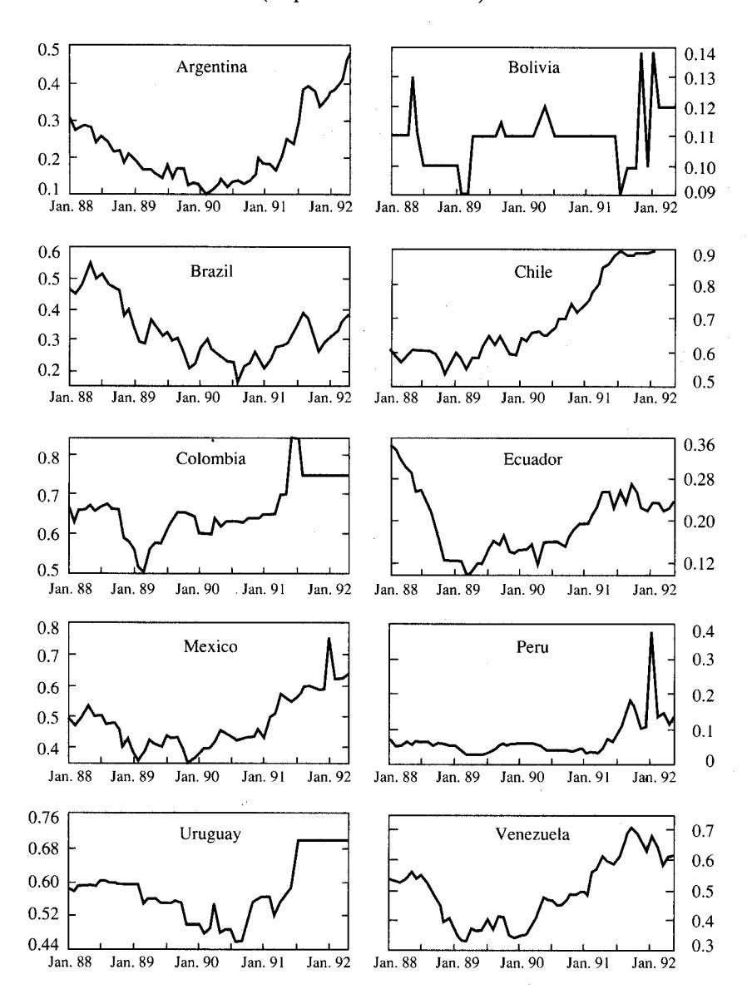

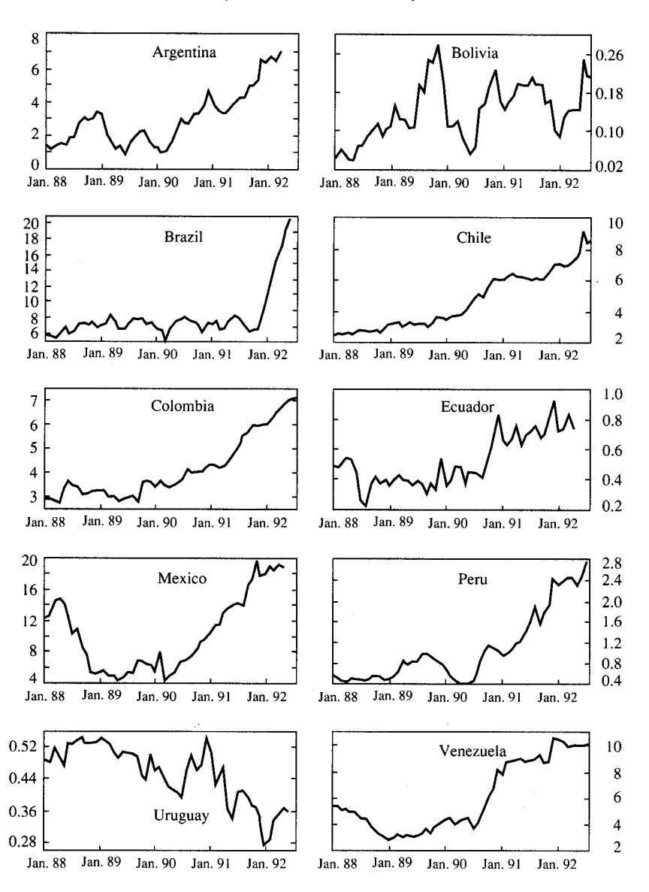

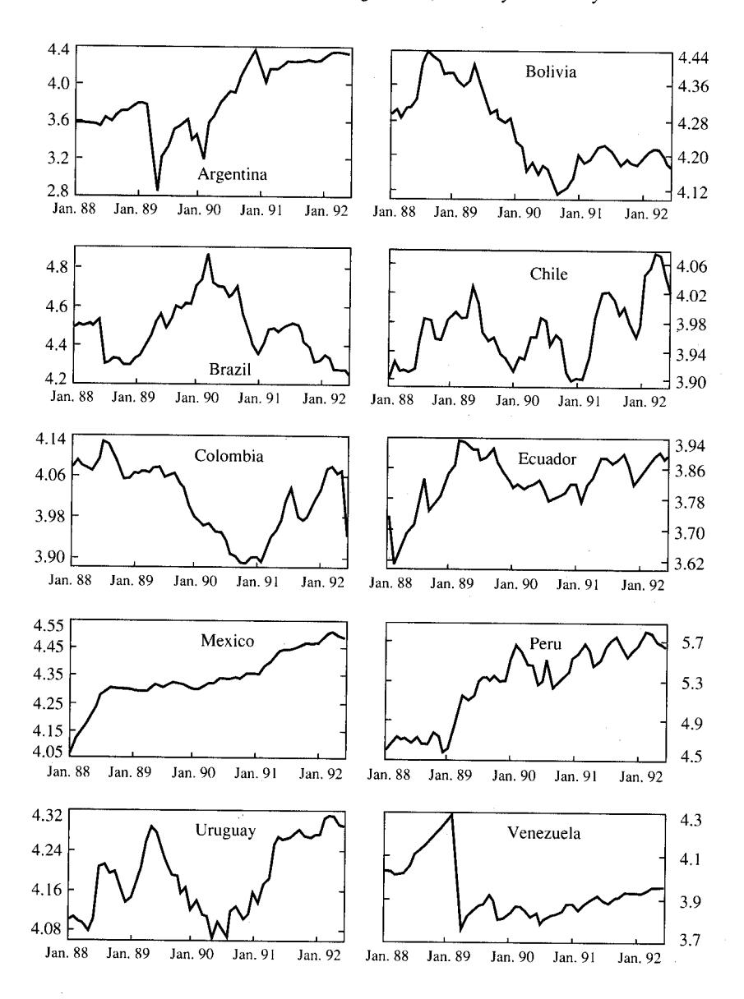

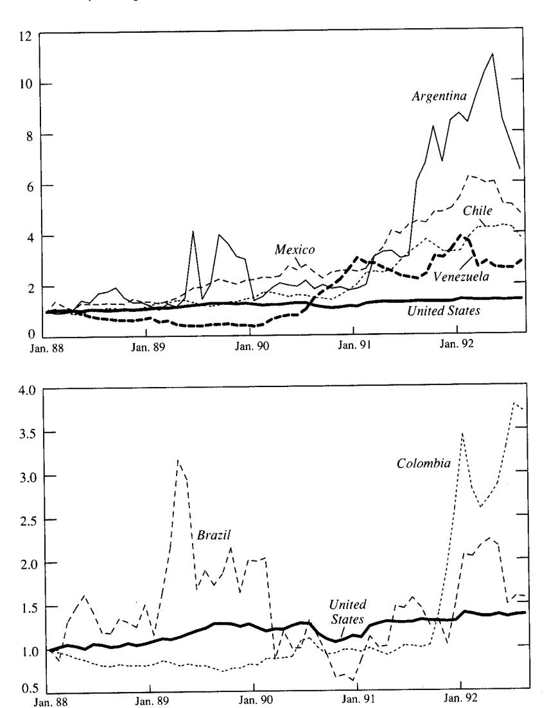

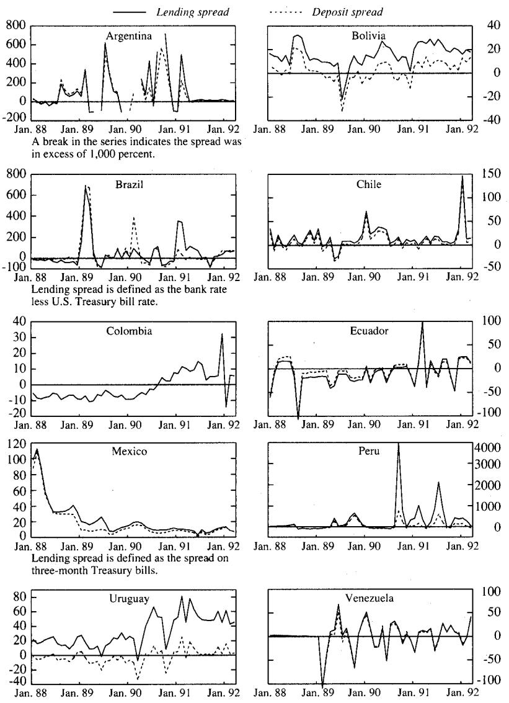

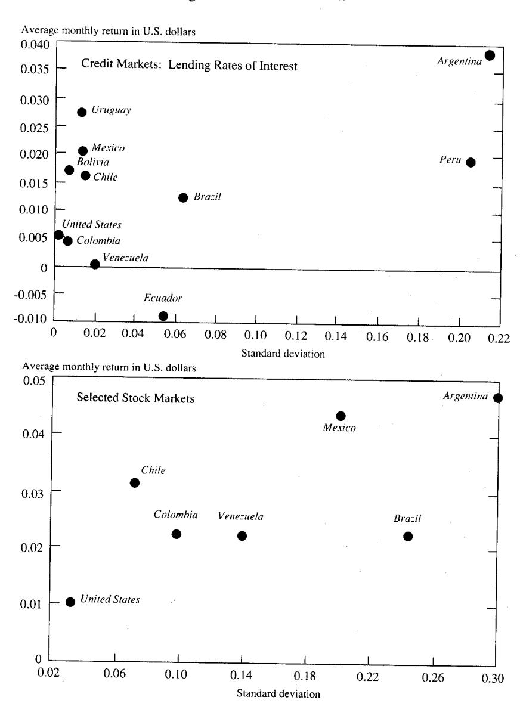

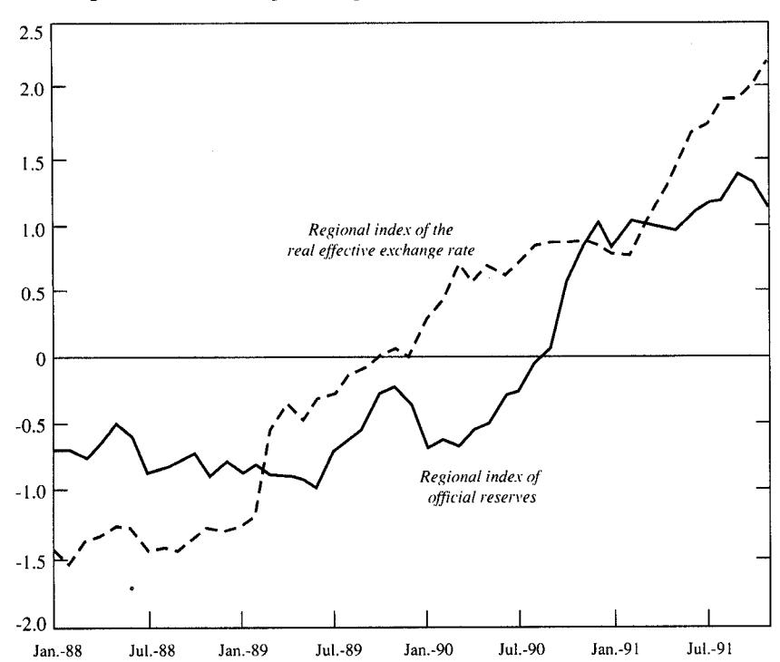

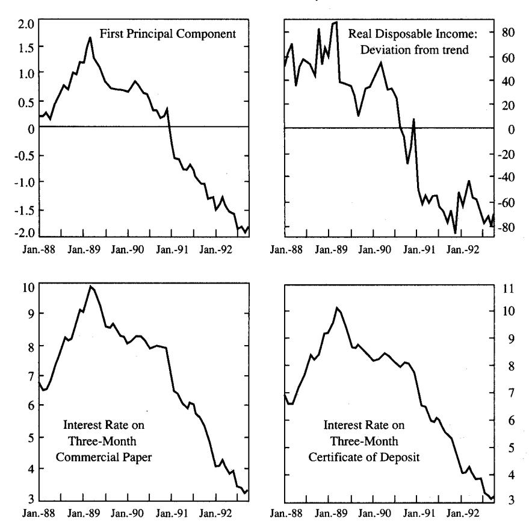

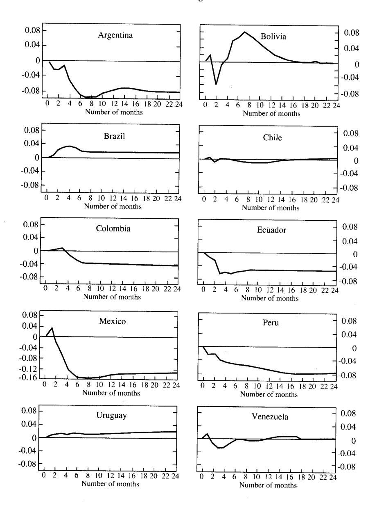

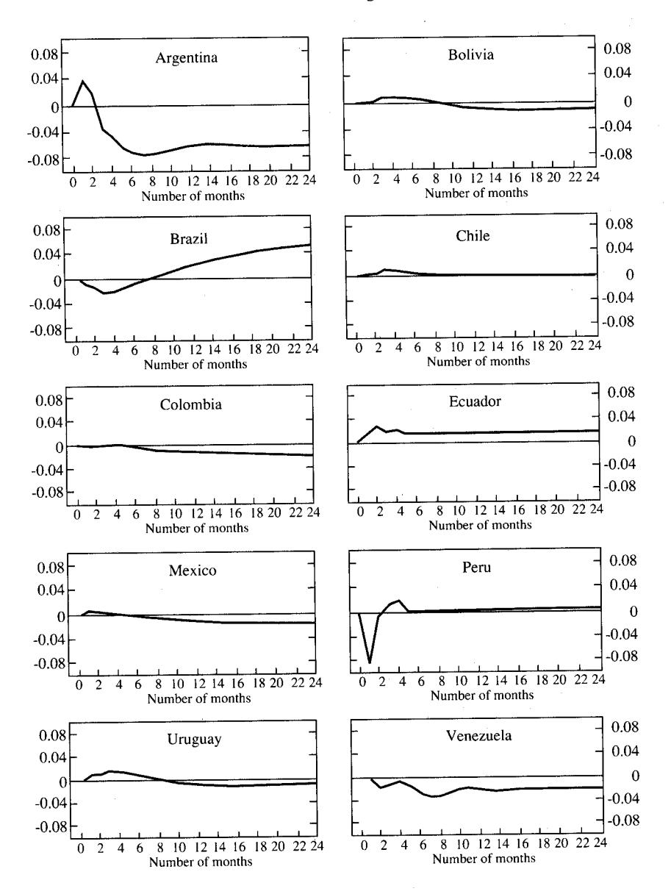

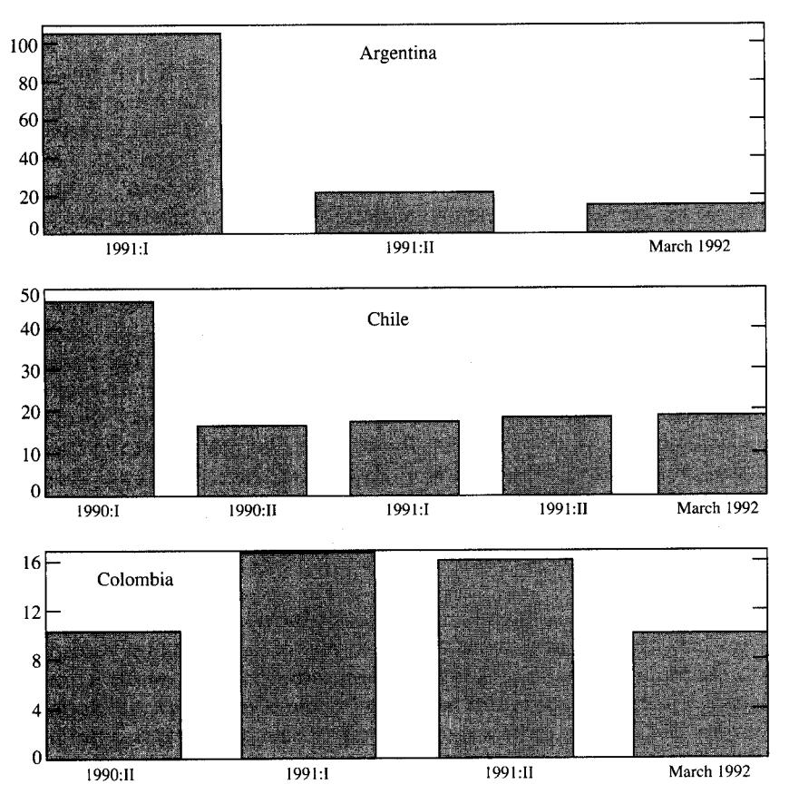

## Pages updated

- [Guillermo A. Calvo](../entities/guillermo-calvo.md) (created)
- [Leonardo Leiderman](../entities/leonardo-leiderman.md) (created)
- [Carmen M. Reinhart](../entities/carmen-reinhart.md) (created)
- [International Monetary Fund](../entities/international-monetary-fund.md) (created)
- [Real exchange rate](../concepts/real-exchange-rate.md) (created)
- [Sterilized intervention](../concepts/sterilized-intervention.md) (created)
- [Latin American capital inflows](../topics/latin-american-capital-inflows.md) (created)
